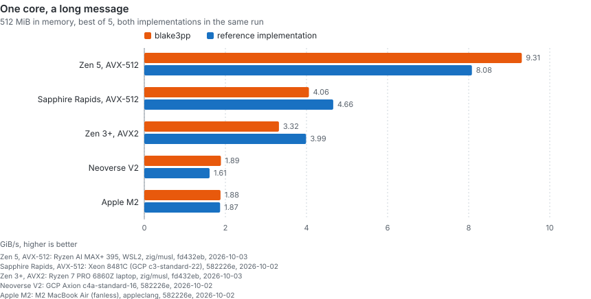
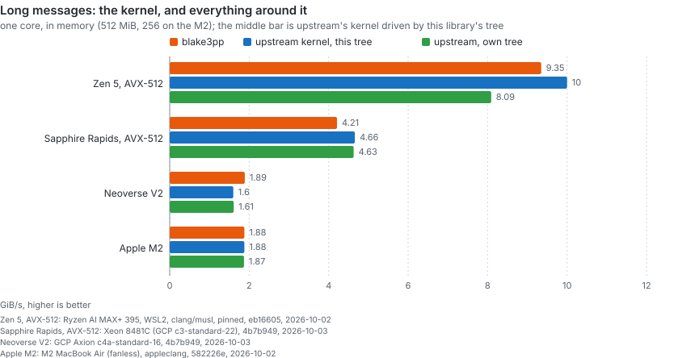
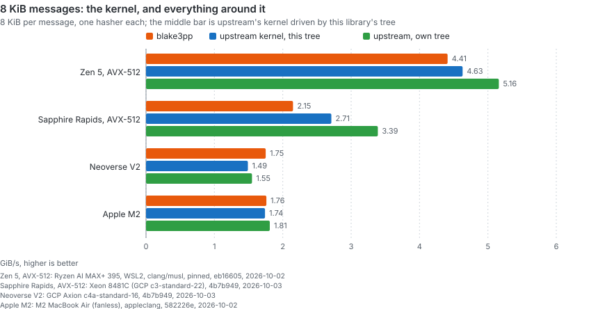
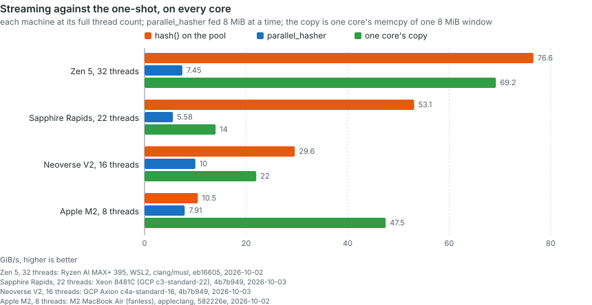
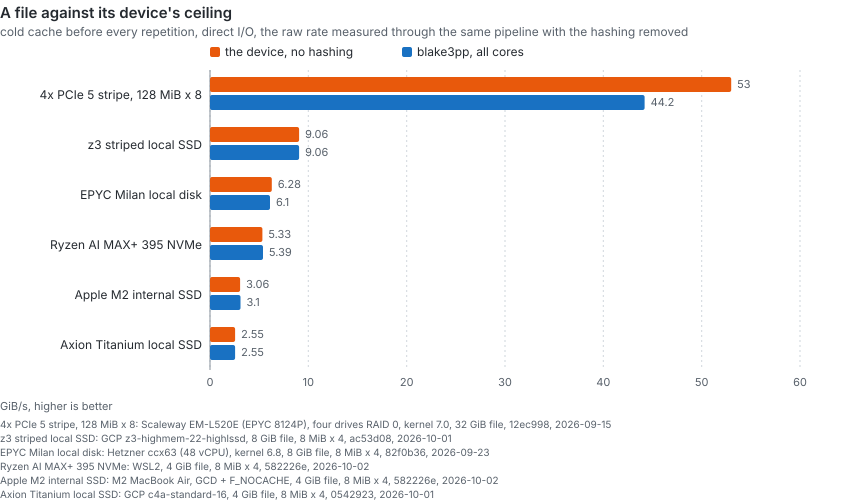
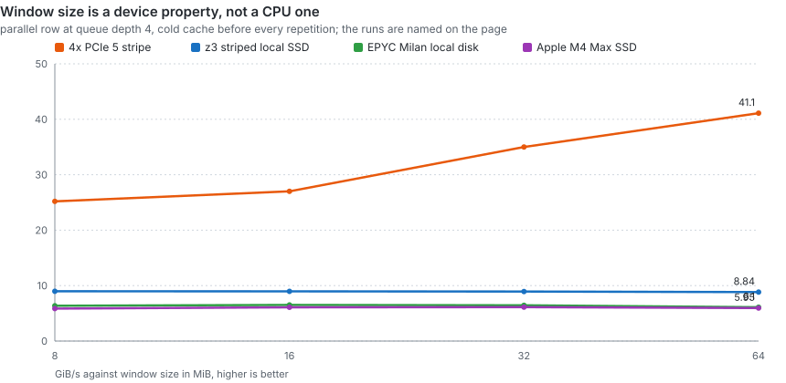

# Performance

[← blake3pp](../README.md)

Every figure on this page was printed by one of the benchmarks in this
repository, on a machine that is named, on a day that is named, and — wherever
the capture recorded one — from a build whose commit is named. A throughput
number without that provenance is not a measurement, so none appears here
without it, and the few captures that lost their commit line say so. A commit
and a date together mean "these binaries, built at that commit, run on that
day", so the two need not coincide. Where a comparison has not been made, the
page says so instead of guessing at it.

The short version. On one core and a long message the library is ahead of
the reference implementation on Zen 5 and on Neoverse V2, level on Apple's
M2, and behind on Sapphire Rapids and Zen 3+. On short messages it is behind
on x86, level on the M2, and ahead where it has an SVE2 kernel and upstream
has none. On every core it scales like the reference implementation's own
rayon path, and the gap that is left is the kernel rather than the
scheduler. On files it reaches the device's ceiling on every device measured
below about 10 GiB/s, and 83% of a four-drive PCIe 5 stripe. Extended output
is the one place where the fat binary wins outright.

## What is measured, and how

### The three programs

| program | what it times | source |
|---|---|---|
| `blake3pp_bench` | kernels, the end-to-end hasher and the parallel engine, in memory | [`bench/throughput.cpp`](https://github.com/pysco68/blake3pp/blob/main/bench/throughput.cpp) |
| `blake3pp_bench_file` | the file pipeline against the device's raw read rate | [`bench/file_throughput.cpp`](https://github.com/pysco68/blake3pp/blob/main/bench/file_throughput.cpp) |
| `blake3-rayon-bench` | the `blake3` crate over rayon, in its own Cargo project | [`bench/compare/`](https://github.com/pysco68/blake3pp/blob/main/bench/compare/) |

`blake3pp_bench` takes `--size` (MiB), `--reps`, `--cooldown` (idle seconds
between passes), `--pin` (a CPU for the single-thread rows), `--threads` and
an optional list of SIMD variants. `blake3pp_bench_file` takes a file or
`--make <MiB>`, plus `--reps`, `--cooldown`, `--window` (MiB), `--qd`,
`--no-direct`, `--inline-submit`, `--threads`, `--seq-only`, `--io-sweep`,
`--trace PATH` and `--trace-agents`; without a device it takes
`--null-source <GiB>` and `--null-sink <GiB>`. `--help` is authoritative on
both.

### The protocol

**The reported figure is the best of N repetitions** — `--reps`, defaulting
to 5 in `blake3pp_bench` and 3 in `blake3pp_bench_file`.
Interference only ever slows a run down, so the best repetition is the one
that measures the machine rather than its neighbours. The benches are
deliberately framework-free; pair them with hyperfine when process-level
statistics are what is wanted.

**The single-thread rows run interleaved, not row by row.** A pass is one
repetition of every row, with the start row rotated per pass, and each row
also prints the CPUs it ran on. Row-by-row order on a heterogeneous machine
lets the scheduler upmigrate the run over time, so whichever rows ran last
win a core class rather than a comparison: on an Exynos 2600 that is a 21%
phantom indistinguishable from a microarchitecture finding. Interleaving
makes placement and thermal history symmetric across rows; `--pin` removes
the variable entirely. The parallel rows are **not** interleaved yet, which
is an open item — on a throttling device, heat currently favours whichever
of them runs later.

**Cooldowns** idle the machine between passes (`--cooldown`, 5 s by
default). On a laptop they are the difference between a measurement and a
thermal curve.

**Cross-implementation runs alternate.** Both implementations are built into
`blake3pp_bench` (`BLAKE3PP_BENCH_UPSTREAM`, on by default) and measured in
the same process, in one interleaved pass. The Rust comparison runs
A/B/B/A at the same size, the same core count and the same pinning. That
alternation is what makes a one-machine comparison mean anything.

**File runs are cold-cache.** `blake3pp_bench_file` drops the page cache
before every timed repetition when it can — `vm.drop_caches=3` on Linux,
`purge(8)` on macOS, and on Windows the three memory commands that empty
working sets, flush the modified list and purge the standby list. It needs
root or an elevated token, and it prints whether the drop happened. With
direct I/O the cache is bypassed anyway, so repetitions measure the device
(or a virtualized disk's host-side cache) rather than RAM; with
`--no-direct` and no drop, every repetition after the first reports RAM
speed, and the report says so in capitals.

**Digests are checked.** Every row records a digest and the benches compare
them, so a kernel that transposes one lane wrong fails the run instead of
printing a plausible number. The Rust sweep checks that every
instruction-set cap agrees on the digest, and the same 4 GiB file hashes to
the same value on Zen 5 under Linux and on an M2.

### What the comparison is against

**blake3pp** is this library end to end, through its own dispatch.

**The reference implementation** appears in three shapes, and the difference
between them is the point:

- *upstream's kernel, this pipeline* — the official BLAKE3 C library's
  hand-written assembly kernels (1.8.6, pinned at `77b257e`) wrapped in a
  `kernel_ops` table and driven by this library's tree, dispatch and
  parallel engine. Only the kernel differs from the blake3pp row, which is
  what isolates codegen from everything around it.
- *upstream, its own code* — the same C library through its own dispatch
  and its own tree.
- *the crate* — the `blake3` crate with rayon driving the tree and
  `update_mmap_rayon` reading files, which is the reference implementation
  as its users get it. One binary per compile-time instruction-set cap,
  because the crate caps its backend through negative features.

On architectures the crate has no backend for — SVE, RVV, VSX, IBM z — its
best path is portable Rust. That is the comparison, not a caveat.

## One core, one long message



The spread across microarchitectures is the result. The same C++ is ahead on
Zen 5 and Neoverse V2, level on Apple's M2, and behind upstream's assembly
on Sapphire Rapids and Zen 3+. Every group is 512 MiB in memory except the
M2's, which is 256 MiB — on a fanless machine the shorter run is the quieter
one, and both implementations hash the same bytes in it either way.

Where the gap is becomes visible once upstream's kernel is driven by this
library's tree:



Four machines, four different answers:

- **Sapphire Rapids.** Upstream's kernel reads 4.66 GiB/s in this pipeline
  and upstream's own code reads 4.63 with the same kernel, so the two trees
  cost the same and the entire 10% gap to this library's 4.21 is kernel
  codegen.
- **Zen 5.** Upstream's kernel reaches 10.0 GiB/s in this pipeline against
  8.09 in upstream's own, a 24% difference from the tree alone, because the
  grouped subtree sweep is worth a fifth of the throughput on this core
  (below). This library's kernel trails theirs by 7%, and the library still
  finishes ahead of their end-to-end row, 9.35 against 8.09.
- **Neoverse V2.** Upstream's kernel measures the same in either tree (1.60
  and 1.61), and this library's own NEON kernel matches it at 1.60 in the
  same run. The 18% lead is one thing only: upstream has no SVE kernel, so
  its best path on this core is NEON and this one's is SVE2 at 128 bits.
  Windows on Arm says the same on
  Cobalt 100 (Neoverse N2, Azure D4ps_v6, clang-cl): 1.95 GiB/s for
  `sve2_128` against 1.36 for upstream's NEON intrinsics.
- **Apple M2.** All three rows land within 1%. A four-lane kernel and a
  flat parent/chunk ratio leave nobody an advantage here.

### Why the tree matters as much as the kernel on Zen 5

A kernel pays for alternating between the 16-block chunk shape and the
1-block parent shape. Measured on Zen 5 with the parent work unchanged and
only its grouping varied: AVX-512 runs at 6.7 GiB/s with one parent call per
leaf, 7.6 bursting the parents over 8 leaves, 7.8 over 32, against 8.5 for
the chunk batches alone; AVX2 reads 3.1, 3.5 and 3.8 against 4.0. The
default path therefore sweeps a group of 8 leaves before reducing their
parents (`src/core/subtree.hpp`), which measured +21% on the AVX-512 row and
+27% end to end on Zen 5.

That win belongs to Zen, not to AVX-512, and the ratio of the parent-shape
ceiling to the chunk-shape ceiling predicts it:

| kernel | chunk shape | parent shape | ratio | what the sweep was worth |
|---|---|---|---|---|
| Zen 5, AVX-512 | 9.49-11.6 | 6.32-6.71 | 58-65% | +21% |
| Zen 3+, AVX2 | 4.01 | 3.48 | 87% | +7% |
| Sapphire Rapids, AVX-512 | 4.33 | 4.17 | 96% | flat |
| Sapphire Rapids, AVX2 | 2.74 | 2.57 | 94% | flat |
| Zen 3+, SSE4.2 | 2.23 | 2.06 | 92% | flat |
| Apple M2, NEON | 2.01 | 2.00 | 99% | flat (-0.5%) |
| wasm simd128, node | 1.60 | 1.28 | 80% | flat (+2-3%) |

(The Sapphire Rapids ceilings are its board bench of 2026-10-02 at
`582226e`; its A/B of the same day read 4.06, 4.06, 4.03 with the sweep
against 4.10, 4.10, 4.10 with the recursion, and upstream's assembly rows
were identical in every round, which is the control that says the harness is
sound. The Zen 5 ceilings are the kernel-ceiling capture below.) Anything
inside about 1% in these benchmarks is this project's noise floor and is not
reported as an effect.

### Where this library's kernel actually stands

The `hash_many` ceiling rows measure a kernel with no tree around it, in the
chunk shape (16 blocks per input) and in the parent shape (one block per
input). On Zen 5, 2026-10-02 at `b6a6e9d`:

| kernel | chunk shape | parent shape |
|---|---|---|
| blake3pp, scalar | 1.44 GiB/s | 1.31 |
| blake3pp, SSE4.2 | 2.62 | 2.36 |
| blake3pp, AVX2 | 4.80 | 4.36 |
| blake3pp, AVX-512 | 11.6 | 6.71 |
| upstream asm, AVX2 | 4.99 | 4.65 |
| upstream asm, AVX-512 | 12.3 | 8.18 |

The AVX-512 kernel here is 6% behind the hand-written assembly on the chunk
shape, where the same run's through-the-tree rows were 21% apart (7.13
against 9.06) and its end-to-end rows 14% (7.14 against 8.29). One block per
input costs both implementations dearly at 16 lanes (6.71 against 11.6 for
this library, 8.18 against 12.3 for upstream), so the per-call setup is not
amortised by a single block; the tree's parent generations are the only
place that shape occurs.

Two kernel changes account for most of what closed the remaining AVX-512
gap, both on Zen 5 and both ABBA:

- **Letting the message array's address escape once**, with an input-only
  constraint and no memory clobber, so the round body reads it through
  memory operands. Sixteen state vectors plus sixteen message vectors is
  exactly the 32 zmm registers an AVX-512 core has. +7.8% on the kernel row,
  +8.5% end to end, with AVX2 (+0.8%, -1.8% over two runs), SSE4.2 (-0.1%)
  and upstream's control row unmoved. That took the kernel from 85% to 92%
  of the assembly. A memory clobber instead loses 4%; per round instead of
  once is no better.
- **A register chaining-value epilogue** instead of one through the stack:
  +16% on the parent shape, +3% on the chunk ceiling, nothing measurable on
  the long row, no regression anywhere.

Inside a wide call, the message transpose is what dominates. Each row below
removes one piece and produces wrong answers, so the figures are ceilings
rather than alternatives (Zen 5, AVX-512, 32 inputs per call, `3f99af4`):

| | parent shape, 1 block | chunk shape, 16 blocks |
|---|---|---|
| as shipped | 8.06 GiB/s | 10.19 |
| without the message transpose | 10.92 (+34.6%) | 12.51 (+21.0%) |
| without the CV slicing | 9.65 (+19.0%) | 11.18 (+8.2%) |
| without the counter stack | 8.47 (+4.4%) | 10.18 (-1.5%) |
| without all three | 12.08 (+48.9%) | 12.66 (+22.5%) |

A 16x16 32-bit transpose costs on the order of 64 shuffle operations against
the round body's 336, so 21% is close to its algorithmic floor. Both
implementations pay it: it is the price of lanes-as-inputs.

### Compilers are part of the result

The same source is not the same code. Each row below is one run, with
upstream's assembly measured in that same run as the control:

| build and machine | AVX-512 kernel | upstream asm, same run |
|---|---|---|
| clang-cl, Windows 11, Ryzen AI MAX+ 395 (`532cc60`, 2026-10-02) | 7.48 GiB/s | 9.21 |
| cl.exe, Windows Server 2025, Azure D4s_v6 Emerald Rapids (`ac53d08`, 2026-10-01) | 3.07 | 5.70 |
| clang, Linux, GCP c4-standard-16 Emerald Rapids (`0b11213`, 2026-10-02, 256 MiB) | 5.08 | 6.18 |

The three rows are three machines at three input sizes, so only each row's
ratio to its own control carries across them — which is the whole point of
having the control. MSVC reaches 54% of the assembly where clang reaches 82%
on the same core
class, and its AVX2 kernel 71% (2.40 against 3.38); its pool row on four
threads reads 7.89 GiB/s against 12.6 for upstream's kernels in the same
pipeline. Digests agree with upstream, so the xsimd backend's AVX-512 path is
correct and this is codegen. It is parked rather than open: cl.exe's
optimizer gives up on the kernel's functions, and forcing it to continue
makes it consume memory without bound, so there is nothing to work on until
that is fixed upstream. MSVC builds stay correct and measured.

Within one operating system the two mainstream compilers are interchangeable
here. On a Ryzen 7 PRO 6860Z under WSL2, three interleaved rounds of GCC 16
against the zig/clang bundle: scalar 750-765 against 780-802 MiB/s, SSE4.2
1.71-1.74 against 1.76-1.82 GiB/s, AVX2 3.06-3.11 against 2.93-3.04, the
end-to-end hasher equal. Within 4% either way, and the sign changes with the
kernel.

The SIMD provider choice was verified rather than assumed, inside one binary
and one run (Zen 5, 256 MiB, ABBA over four passes, `582226e`). Forcing the
x86 kernels onto the vector-extension provider in a clang build, against the
xsimd they normally get: SSE4.2 2.25-2.28 against 2.29-2.31, AVX2 3.85-3.86
against 3.88-3.90, AVX-512 8.69-8.77 against 8.40-8.43, end to end 8.59-8.75
against 8.47-8.62. Equivalent within the noise floor, xsimd marginally ahead
at AVX-512. Under GCC the answer is clearer the other way: `std::simd` 8.24
against the vector extensions' 7.93 at 64 bytes, and 4.7 against 2.3 at 32
bytes. [Polyfills](polyfills.md) covers which provider a build picks.

Comparing providers across two probes rather than inside one run produced a
phantom 20% gap once, from two different input counts and two different link
setups. Compare inside one binary and one run, or not at all.

### What the fat binary costs at the call boundary

Every hashing call goes through a pointer to the running variant's
`kernel_ops` table, and the kernel bodies live in translation units of their
own, so nothing inlines across that boundary.
`blake3pp_dispatch_cost_<variant>` isolates what that costs by calling one
body three ways on one pinned core — through the table, through a `noinline`
wrapper, and by name in the same translation unit.

On a Zen 3+ (Ryzen 7 PRO 6860Z, GCC 16) the dispatch is one instruction, the
load of the function pointer; the indirect call replaces a direct call one
for one and is predicted, since the branch-miss rate through the table equals
the rate by name. At the library's leaf batch that is 0.002-0.003% of the
instructions on every variant, flat across widths, and in cycles it sits
inside the 2% run-to-run noise. Per 64-byte block — the path a message
shorter than a chunk takes, and the worst case — it is 0.1% of the
instructions and 3-18 cycles of about 300 under GCC; under clang, zero extra
instructions at the leaf batch, two per block, and no cycle difference at
all.

One machine charges more, and only on that worst-case shape. On a 48-thread
EPYC Milan (2026-09-13), one dispatched call per 64-byte block costs 320-328
cycles against 276-277 called by name: +43 to +53 cycles, 16 to 19%, for
three instructions fewer. At the leaf batch and at 64 chunks per call the
same run reads -0.3% to +1.0%, which is nothing. So the indirect call is free
wherever a call covers a batch, and visible only where a call covers one
block — the path the short-message section is about for other reasons.

The detection ladder is paid once per process. The first library call builds
the availability table in 7 to 20 µs under WSL2, the second call takes
50 ns, and constructing a `hasher` 0.6 µs; those microseconds are `cpuid`
trapping to the hypervisor, and on bare metal the whole ladder is about a
microsecond. Code size: every SIMD variant a platform gets adds about 40 KB,
and all of them together are 8-9% of a 1.55 MB static `blake3ppsum`.
[bench/README.md](https://github.com/pysco68/blake3pp/blob/main/bench/README.md)
has the exact instruction counts, the two GCC flags the bench needs to
measure what the library pays, and the disassembly per ISA.

## Short messages


8 KiB per hasher, one hasher each, from the same runs as the long-message
chart: no tree worth spreading over cores and no long run to amortise a wide
batch over, which is the shape that shows per-call overhead rather than
kernel throughput. **This is where the library is furthest behind on x86.**

The same three-way decomposition applies:



On Zen 5 the kernel accounts for 5% of the gap (4.41 for blake3pp, 4.63 for
upstream's kernel in this tree) and the remaining 11% to their 5.16 is their
code around it. On Sapphire Rapids the split is roughly even: 2.15 to 2.71
for the kernel swap, 2.71 to 3.39 for the rest.

### What the "rest" is: lane granularity

This library's `hash_many` pads a remainder below the kernel's width out to
full width, repeating the last input. Upstream's x86 kernels instead cascade
16-lane,
8-lane, 4-lane and single-block paths behind one entry point, all in the
same ISA (`c/blake3_avx512.c:1313`), so eight inputs are a true 8-lane
AVX-512 batch rather than a padded 16-lane one.

Measured per kernel on Zen 5 (512 MiB in 8 KiB messages, `a584f6a`,
2026-10-02), as a fraction of each row's own long-input rate. This run
predates the grouped subtree sweep, so its long-input column is lower than
today's — the ratios are what the run was for:

| row | long input | 8 KiB messages | kept |
|---|---|---|---|
| scalar | 1.23 GiB/s | 1.23 | 100% |
| SSE4.2 | 2.03 | 2.11 | 104% |
| AVX2 | 3.29 | 3.14 | 95% |
| AVX-512 | 6.42 | 4.24 | 66% |
| AVX-512, upstream's kernel in this tree | 8.00 | 4.46 | 56% |

Where an eight-chunk message fills the lanes, the short-message rate *is*
the long-input rate. The one row that collapses is AVX-512, and it collapses
for upstream's own AVX-512 kernel too when this library's `hash_many` drives
it, which is what says the cause is lane granularity rather than this
library's tree code.

The second half is the parent spine. Below `2 * simd_degree` chunks every
parent is a scalar single-block compression — six of them for an 8 KiB
message, about 300 ns of a 1.7 µs message — where upstream always passes a
lanes-wide batch. A counting `kernel_ops` table confirmed the shape.

### What llvm-mca says

Run on the AVX-512 variant's own assembly (clang 22, the project's flags,
`-mcpu=znver5`), one function per region:

| shape | instructions | mca cycles | port-bound | measured on Zen 5 |
|---|---|---|---|---|
| one-block batch, 16 lanes (the parent shape) | 1215 | **532** | 285 | ~115 ns ≈ 540 cycles |
| one scalar block (`compress_in_place`) | 779 | **224** | 130 | ~60 ns ≈ 280 cycles |

Both single-block shapes run at about **1.9x their port-limited bound**, and
the measured times sit on top of the cycle counts. They are dependency-bound
on the BLAKE3 round chain, not throughput-bound: the ports have most of a
second batch's worth of room to spare. So filling more lanes in one parent
call cannot recover what a dependency chain is spending; interleaving two
batches could, which is why the leaf path already spans two batches.

### What was tried, and what it cost

- **Batching the parent generations of a short batch.** The right shape,
  confirmed with a counting kernel table: eight chunks give one 4-lane
  generation and one 2-lane one, which is what upstream has. Faster where
  the input is cache-resident (3150 to 2750 ns per 8 KiB message on Zen 3+
  at AVX2, equal to base on Zen 5 over 2 MiB) and **21% slower** over
  512 MiB on Zen 5, 4.66 against 3.68 GiB/s, reproducibly and in both
  orders.

  | 8 KiB messages, Zen 5 AVX-512 | 2 MiB | 32 MiB | 512 MiB |
  |---|---|---|---|
  | base | 4.70 / 4.57 | 4.62 / 4.55 | 4.49 / 4.57 |
  | per generation | 4.72 / 4.74 | 3.87 / 3.93 | 3.63 / 3.65 |
  | same, scalar parents | 4.61 / 4.52 | 4.54 / 4.59 | 4.60 / 4.62 |

  The third row settles where the cost lives: the same discovery and rebuild
  with the parents compressed one scalar block at a time measures as base at
  every size, so the bookkeeping is free and the whole regression is in the
  two extra `hash_many` calls. Why two calls that do strictly less
  arithmetic cost a fifth of a message only once the input stops fitting in
  cache is not established, and the measurement is recorded without an
  explanation rather than with a guessed one.
- **Folding each canonical subtree of a short batch** before the chaining
  values leave: 2.3% slower on Zen 5 at AVX-512, no round where it won,
  because the cap that keeps a last subtree for ROOT splits eight chunks
  into two groups of four and each group's first generation is then two
  lanes, which `hash_many` runs one input at a time.
- **Handing a batch's remainder to the next ISA down.** +3.6% on an 8 KiB
  message on Emerald Rapids, -10.5% on Zen 5, because a padded 16-lane
  AVX-512 batch is still faster than a true 8-lane AVX2 one (5.9 against
  4.8 GiB/s of useful work on Zen 5). Taken back out. The remainder's best
  kernel is a per-machine property with no feature bit to report it: on
  Sapphire Rapids the padded AVX-512 8 KiB row (2.15) is *slower* than the
  AVX2 one (2.18), the opposite of Zen 5.
- **A wide fold of each batch's chaining values**: 0-3% at every message
  size from 8 KiB to 1 MiB. Dropped; it does not pay for the code.

Two things that did land and are worth the API note. `update_last()` tells
the hasher the message ends with these bytes, which lets the final chunk
join a wide batch instead of being compressed a block at a time: 8 KiB
messages went 2.04 to 2.83 GiB/s on AVX2 (+39%), 24 KiB +10%, 56 KiB +2%,
120 KiB and above unmoved. And moving the decomposition policy out of
`update()` into `core::compress_chunks` took 8 KiB messages from 1.18 to
2.05 GiB/s on AVX2 and 1.18 to 1.40 on SSE4.2, with the long rows unmoved.

### What a narrow same-ISA kernel would be worth

The parent shape is the machine-independent half: one block per input at
four or eight lanes wins 17-38% on Zen 5 and is flat on Sapphire Rapids.
Against an 8 KiB message's ~300 ns of scalar spine in a 1.7 µs message, that
is 6-9% on short messages and about 1% on long ones, for two more variants
in the fat binary and a cascade inside `hash_many`. It is not built. The
chunk shape goes the other way and goes it differently per machine: a true
8-lane batch reads 4.57 GiB/s on Zen 5 against 5.87 for a padded 16-lane one
at eight inputs, while on Intel upstream's native 8-lane path reaches 2.85
in this tree against this library's padded 2.15.

## Every core


`blake3pp pool` is the engine over its `std::execution` pool.
`reference kernel, same pool` is the same engine with upstream's kernel
swapped in, so the two differ only in the kernel. `crate rayon` is the
reference implementation's own parallel path.

### The engine against a work-stealing pool

The control that matters is the middle line against rayon: the same kernel,
one driven by senders and receivers, the other by a work-stealing pool
written for the job.

| machine | threads | rayon, relative to the same kernel in this engine (negative: this engine ahead) |
|---|---|---|
| Neoverse V2 (c4a-standard-16) | 1 / 2 / 4 / 8 / 16 | +0.0% / -0.3% / +0.3% / +1.4% / +2.1% |
| Sapphire Rapids (c3-standard-22) | 1 / 2 / 4 / 8 / 16 / 22 | -5.0% / -9.2% / -7.4% / -7.3% / -4.6% / -1.3% |

(2026-10-03, `4b7b949`.) A sender/receiver engine costs nothing against a
work-stealing pool at this granularity, and on Sapphire Rapids it is ahead.

The fixed-share control says why work stealing is there at all. `reference
static` hands out 256 equal shares in one bulk call, so it joins on its
slowest agent. With the kernel held still on Sapphire Rapids, the
counter-pulled engine reads 51.8 GiB/s at 16 threads and the fixed shares
39.4 — a 31% difference on one machine at one thread count — while at 22
threads the two are 55.1 against 51.2, 7.6% apart. The effect grows with the
thread count and with core heterogeneity. On a 48-vCPU EPYC
Milan (Hetzner ccx63, 2026-09-11), with upstream's assembly held still, parts
pulled from a counter read 101.0 GiB/s at 48 threads where fixed shares read
87.4 and rayon 95.2; on an M4 Max (12 performance cores and 4 efficiency
cores, 2026-09-15) the counter reads 28.7 against the fixed shares' 23.1, a
24% gain and the largest on any Apple machine.

On the M2, `stdexec` over GCD and `stdexec`'s own pool measure the same:
10.5 GiB/s both, with upstream's kernel in the same pool at 10.6 and rayon
at 10.57.

Two other machines at 16 threads, with the same three columns (2026-10-01,
`ac53d08`):

| machine | one thread, blake3pp / upstream | this engine | upstream's kernel, this engine | crate rayon |
|---|---|---|---|---|
| Emerald Rapids (8581C) | 5.02 / 6.15 GiB/s | 43.6 | 45.4 | 44.2 |
| Zen 5 (EPYC 9B45) | 7.02 / 7.76 | 44.4 | 46.7 | 44.3 |

The multi-core row sits 4-5% under upstream's kernels run through this same
pipeline — the kernel gap diluted by the fan-out — and level with rayon.

### Where the gap on every core comes from

On Zen 5 under WSL2 at 32 threads the engine reads 76.6 GiB/s, upstream's
kernel in the same engine 81.7, and rayon 71.6 (`eb16605`, 2026-10-02). So
the scheduling is 7% ahead of rayon and the kernel 6% behind the assembly:
the multi-core gap is the kernel carried through rather than a scaling
problem. The clang-cl build of the same chip under Windows says it the same
way from the other side (`532cc60`, 2026-10-02): 76.8 GiB/s on 32 threads
against 86.9 for upstream's kernel in this engine and 86.92 for rayon, 88% of
both, with the pipeline scaling 10.1x on 32 threads where rayon scales
10.3x.

The two runs disagree about rayon, not about this engine, and that is itself
worth recording: on the same chip at 32 threads this engine reads 76.6 GiB/s
in WSL2 and 76.8 under Windows, while rayon reads 71.6 and 86.92. An earlier
pair of runs on that machine measured the same split with the kernels held
still — rayon ahead of the engine by 6.3-6.4% on Windows and behind it by
10.6% in WSL2 (2026-09-11). A cross-runtime comparison therefore belongs to
the operating system it was taken on.

Measuring one shape at a time explained the last 6% of it (Zen 5, one core,
`1213629`, 2026-10-02):

| shape | blake3pp | upstream asm |
|---|---|---|
| long message, end to end | 9.08 GiB/s | 9.71 |
| `hash_many` alone, one batch | 11.9 | 12.2 |
| `hash_many` alone, two batches | 11.8 | 11.9 |
| the parent shape, one block per input | 9.42 | 8.07 |
| the engine's pool row, one thread | 8.79 | 9.48 |

This library is *faster* at parents and within 2.5% at chunk batches, and
still loses 6-7% wherever the two alternate closely. Composing the two
measured rates predicts a 1.2% gap for the engine's per-part work against a
measured 7.3%.
Giving the part reduction the same burst shape as the subtree sweep moved
the engine's one-thread row from 8.84-8.87 to 9.09-9.27 GiB/s over four
alternating rounds, and about 2% at 32 threads with no round slower at 16 —
which is at the noise floor and is not the reason it was taken.

One hypothesis died there: message pinning was suspected of costing
throughput when two SMT siblings share a core's load/store unit. It does
not. At 32 threads on 16 cores the pinned build read 76.9 / 78.7 / 76.7
GiB/s against 74.6 / 74.3 / 75.2 unpinned.

### Streaming: `parallel_hasher`'s ceiling



`parallel_hasher` is the incremental counterpart of the multi-core `hash()`,
and it streams far below it. The cause is recorded and it is outside the
hash.

Each `update()` completes its windows before returning, so consecutive
windows never overlap and every flush pays for its own pipeline scope, where
the one-shot amortises one scope over the whole span. On top of that, a feed
of at most one window copies every byte into the window buffer on the
*caller's* thread before the window can be fanned out, and the pool parks
while that happens, so each window's fan-out then starts cold. On the Z13
(Ryzen 7 PRO 6860Z, 16 threads) an 8 MiB `hash()` takes 430 µs back to back
and 709 µs after the pool has been idle for 20 ms, and one thread's memcpy
of 8 MiB runs at 6.4 GiB/s there.

The feed size is therefore the lever, because it decides how much copying
there is — a feed of one window copies all of it, a feed of eight copies an
eighth (Z13, `de0d3b6`, 2026-10-01):

| window | feed 256 KiB | feed 1 MiB | feed 8 MiB |
|---|---|---|---|
| 8 MiB | 4.82 | 6.30 | 5.94 |
| 1 MiB | 2.72 | 2.65 | 7.96 |
| 256 KiB | 2.94 | 3.01 | 7.42 |

A feed larger than the window hashes whole windows in place and copies only
the last. A window smaller than the feed costs a scope and a cold fan-out
per window instead. **Every stream row in the charts and reports feeds at
most one window, which is the worst case by construction**; the bench prints
the copy's own rate above those rows for that reason. Read that copy row as
an upper bound on the copy and not as a DRAM figure: it times one window
copied repeatedly, so both ends stay wherever the caches hold them, which is
why it reads 69.2 GiB/s on a Zen 5 with a large last-level cache and 13.5 to
14.0 on a Sapphire Rapids in the same bench.

Two cloud machines of the same vintage differ by 3x on these rows and not at
all on the pool rows — 5.16-5.25 GiB/s on c4-standard-16 (Emerald Rapids,
pool 43.6) against 17.0-17.4 on c4d-standard-16 (Zen 5, pool 44.4),
2026-10-01 at `ac53d08`. What differs is one core's copy bandwidth and how
fast a parked pool wakes, which is what a VM's idle handling and a core's
store bandwidth set.

A copying streaming mode over context-owned window storage would lift this,
at the cost of the copy; it is an open item rather than a plan.

## Files

### The ceiling is the device

`blake3pp_bench_file` measures the raw device read rate first, through the
identical windowed pipeline with the data delivered and discarded, and then
hashes for real. The utilization column relates the two: 100% means the
drive is the limit, not the hash.



Six devices, five on Linux and one on macOS, and only the four-drive PCIe 5
stripe is fast enough for the hash to become the limit: at 128 MiB x qd 8 it
reads 53.0 GiB/s and hashes 44.2, 83% of the device. Everything slower than
about 10 GiB/s is read-bound, and the parallel row sits at the raw rate.

One bar in that chart is a single round rather than a pair: the ccx63's own
rounds spread 6.02 to 6.39 GiB/s raw and 5.88 to 6.38 hashed, so read it as
"at the device" and not as a figure to three digits. Every other group
reproduced across its rounds to within 1%.

The small devices make the same point more bluntly. On a 215 MiB/s GCP boot
disk the parallel row reads 225 MiB/s, and the crate's `mmap` and
`mmap+rayon` paths read 0.21 GiB/s, which is the same number: every path is
the disk (2026-10-01, `ac53d08`, 1024 MiB file). The Azure D4pds_v6 local
NVMe at 690 MiB/s is 100% of raw on every arm of a three-way A/B
(`0542923`, 2026-10-01). The Azure Windows-on-Arm OS disk runs at its
402 MiB/s with IOCP direct where the crate's mmap gets 0.37 GiB/s, and the
Windows x64 OS disk at 185 MiB/s against the crate's 0.18 (both `ac53d08`,
2026-10-01).

The head-to-head on a fast NVMe is the clearer story. Ryzen AI MAX+ 395
under WSL2, 4 GiB file on the Linux filesystem, cold cache before every
repetition, 2026-10-02 at `582226e`. Direct I/O behaves normally on this
machine's virtual disk — the raw row reads 5.33 GiB/s and the pipeline sits
at 101% of it — unlike the devcontainer's WSL2 disk in the caveats below,
where a direct write collapses:

| | GiB/s |
|---|---|
| raw io, no hashing (the device) | 5.33 |
| blake3pp, direct I/O, one thread | 5.38 |
| blake3pp, direct I/O, 32 threads | 5.39 |
| blake3pp through the page cache | 5.08 |
| the crate's mmap, one thread | 0.97 |
| the crate's mmap + rayon | 4.88 |

Hashing a 4 GiB file costs nothing over reading it — 101% of the raw
ceiling, because the pipeline overlaps the read with the hash. Direct I/O
beats this library's own page-cache path by 6% and the crate's recommended
`update_mmap_rayon` by 10%; the crate's single-threaded mmap is 5.5x slower
than one thread of this pipeline, which is the page cache serving a reader
that cannot ask for the next block early.

The same file on an M2 MacBook Air (`582226e`, GCD + `F_NOCACHE`): raw 3.06
GiB/s, sequential 1.80 (59% of raw), parallel 3.10 (101%). One NEON core is
the limit for the sequential row and the engine still reaches the device.
With the page cache warm — `purge` was denied on that machine, so the rows
are warm by admission — raw reads 17.6 and the parallel row 7.58, which is
the shape of a run where the hash has become the limit.

### Command line against command line

`blake3ppsum` against `b3sum`, cold cache before every timed run, each tool
as it ships:

| machine | b3sum (mmap + rayon) | blake3ppsum (direct I/O) | one thread each |
|---|---|---|---|
| Scaleway EM-L520E, 4x PCIe 5 stripe, kernel 7.0, 32 GiB, `12ec998`, 2026-09-15, b3sum 1.8.2 | 1.059 s, 30.22 GiB/s | 1.262 s, 25.35 GiB/s — and 0.803 s, 39.84 GiB/s at `--window 64 --qd 4` | 3.17 against 3.47 GiB/s |
| M2 MacBook Air, 1024 MiB, `91b789a`, 2026-09-11, b3sum 1.8.7 | 1.076 s, 0.93 GiB/s | 0.373 s, 2.68 GiB/s | 0.48 against 1.67 GiB/s |

Digests agree in both. The two rows say different things: on the stripe the
default window is what costs, and with the geometry the sweep found,
`blake3ppsum` is 32% ahead of `b3sum`; on the M2 the default is already
right and direct I/O is worth 2.9x over `mmap`. Through the page cache
instead, `blake3ppsum --no-direct` takes 5.765 s on the stripe (5.55 GiB/s),
which is the Linux buffered-read path below.

### Window and queue depth are a device property

The right window size and queue depth are set by the device's bandwidth and
latency, not by the CPU, which is why `--io-sweep` exists and why it is run
per machine.



Three of those four devices barely care: across the sweep's 8x window range
at queue depth 4 the z3 moves 1.6%, the M4 Max 4.4% and the ccx63 6.9%, and
each one's best cell beats its own 8 MiB x qd 4 default by 0%, 6% and 3%. The
four-drive PCIe 5 stripe is moved by 63% (25.2 GiB/s at the default, 41.1 at
64 MiB x qd 4). Queue depth is the smaller lever on all four, but not a flat
one: on the stripe the 64 MiB row itself spans 38.7 to 41.1 across qd 4 to
32. The four devices are three Linux hosts and one Mac; no Windows machine
has an `--io-sweep` capture.

The runs, all with the default `offload_submit`: Scaleway EM-L520E
four-drive stripe on kernel 7.0, 32 GiB file, 2026-09-15; GCP
z3-highmem-22-highlssd, 8 GiB, 2026-09-11; Hetzner ccx63 local disk, 8 GiB,
2026-09-23; Apple M4 Max internal SSD, 8 GiB, 2026-09-15. A fifth device, a
single GCP local SSD, reads 5.87 to 6.02 GiB/s across all sixteen cells of
its own sweep. These five sweep captures carry no commit line of their own,
only the machine and the day; the Scaleway one is dated by its sibling
captures at `12ec998`.

The stripe's whole shape, same machine and day, with the raw row beside each
cell:

| geometry | the device | blake3pp, all cores | with `--inline-submit` |
|---|---|---|---|
| 8 MiB x qd 4 (the default) | 43.2 GiB/s | 25.3 (59% of raw) | 31.4 raw, 16.7 hashed |
| 64 MiB x qd 4 | 51.0 | 41.0 (80%) | 35.8 raw, 22.2 hashed |
| 128 MiB x qd 8 | 53.0 | 44.2 (83%) | 35.1 raw, 21.7 hashed |

The third column is `offload_submit` turned off, and it is the reason the
option defaults on. Issuing a 64 MiB direct read costs 1.5-1.9 ms of
pinning, splitting and queueing on kernel 7.0; inline, the thread that pays
it is also the thread waiting for the hash, which halves the pipeline, and
asking io_uring for the hand-off restores it. The sweep run on the same
machine reads 41.1 GiB/s best with the hand-off and 22.2 without.

The 8 MiB x qd 4 defaults were tuned on low-latency NVMe and also measure
23-25% slow on GCP pd-class volumes, where 32 MiB x qd 16 recovers it. The
measured sweet spot on every device so far is a queue depth of four to
eight; the ceiling is 256 windows in flight, each of `window_bytes`, and
`BLAKE3PP_MAX_QUEUE_DEPTH` moves it.

The write side has a different shape, because one window's fill is
sequential — the parallelism is the windows in flight, not a fan-out inside
one. `--null-sink` measures it with the device removed (Z13, 16 threads,
2 GiB, best of 3):

| geometry | GiB/s | | geometry | GiB/s |
|---|---|---|---|---|
| 64 MiB x qd 2 | 8.56 | | 16 MiB x qd 8 | 16.2 |
| 64 MiB x qd 4 | 14.6 | | 8 MiB x qd 16 | 17.1 |
| 64 MiB x qd 8 | 16.8 | | 4 MiB x qd 16 | 18.5 |
| 64 MiB x qd 16 | 16.9 | | | |

Doubling the depth from 2 to 4 nearly doubles the rate; from 8 to 16 it buys
nothing, because by then there are more windows than the generator has cores
to fill. The window *size* barely matters across a 16x range. So the one
tuning lever on the write side is the queue depth, and the useful setting is
about the core count. On four PCIe 5 drives in RAID 0 with 32 threads and
32 GiB written, the writer's own default geometry measured 24.2 GiB/s at
64 MiB x 2 and 23.8 at 64 MiB x 4, against 20.7 at 128 MiB x 4 and 14.8 at
256 MiB x 8: past a few hundred MiB in flight a striped volume slows down.

`--null-source` is the read side's equivalent and is a **ceiling, not a
throughput**: the driver owns only `windows x window_bytes` of buffer and
hands every window the same slice, so the bytes are cache-resident by
construction and the figure is an upper bound on the engine with the device
removed. It is not comparable to `blake3pp_bench`'s `hash()` rows, which hash
a real span. Where it is used is for engine changes, because it is the only
measurement a device cannot hide. Medians over four alternating rounds,
8 GiB, 2026-10-01, the arm built at `ac53d08`:

| machine | 8 MiB x qd 4 | 64 MiB x qd 4 |
|---|---|---|
| Zen 5 (EPYC 9B45, c4d-standard-16, 16 vCPU) | 49.65 GiB/s | 45.60 |
| Emerald Rapids (8581C, c4-standard-16, 16 vCPU) | 44.10 | 43.60 |
| Axion (Neoverse V2, c4a-standard-16, 16 vCPU) | 28.70 | 29.60 |

Queue depth barely moves those: within 1% from 4 to 16 on all three, with
qd 32 costing 2% on the Emerald Rapids and 4% on the Zen 5. Two more
machines were measured a week earlier, before the grouped window fold, so
their figures are not comparable to the three above: a z3-highmem-22 driving
a 48-thread pool read 36.30 and 43.45, and a ccx63 driving a 16-thread pool
38.30 and 40.85 (`82f0b36`, 2026-09-23).

One measured engine change was read off this bench: giving a window's parts a
grouped fold inside the bulk was worth +13.8% on the Emerald Rapids and
+2.8% on the Zen 5 at 8 MiB windows, and nothing at 64 MiB.

### Direct against buffered

With direct I/O the page cache is bypassed, so each repetition measures the
device. Buffered reads measure the same as direct ones on Windows and on
macOS on every machine tried — on an M4 Max over an 8 GiB file (2026-09-15)
the parallel row reads 6.12 GiB/s buffered against 5.86 direct, 4% ahead of
`F_NOCACHE`. On Linux the two diverged, and
the trace said whose cost it was (2026-09-19, `f524842`, 8 GiB, cache dropped
per repetition):

| machine | direct, raw | buffered, raw | io-wq cores, buffered |
|---|---|---|---|
| ccx63, 48 vCPU EPYC Milan, local disk, kernel 6.8 | 6.79 GiB/s | 3.84 | 2.68 |
| z3-highmem-16, two local SSDs RAID 0, kernel 7.0 | 6.03 | 6.03 | 2.13 |

On the 6.8 kernel the reading thread spent 72% of wall time inside the
kernel's own buffered-read copy path. On 7.0 the buffered rate equals the
direct one, so that half-speed path is the kernel's rather than this
library's, and it is gone. What remains of buffered I/O's cost is the copy
itself, two cores' worth at 6 GiB/s, which direct I/O does not pay at all
(0.07-0.14 cores of io-wq).

That is settled up to about 6 GiB/s and not above it. On the four-drive
PCIe 5 stripe with kernel 7.0, `blake3ppsum --no-direct` reads 5.55 GiB/s
where `b3sum`'s `mmap + rayon` through the same page cache reads 30.22, and
on a 9 GiB/s z3 the buffered path caps near 3.2-3.5 where `mmap` reaches 8.7.
Whether that ceiling is the kernel's or this library's buffered reader has
not been established; it is an open item.
[Direct I/O](direct-io.md) covers when turning it off is the right call.

A virtual disk inverts the trade. On ext4 on a WSL2 virtual disk, the same
write pipeline measured ~0.15 GiB/s with `O_DIRECT` against ~2.0-3.5
buffered, with a run-to-run spread of 0.07 to 2.24 GiB/s from one binary.
Nothing about a storage path can be concluded from such a machine.

### Where a window's time goes

`--trace` records five timestamps per I/O window and, with `--trace-agents`,
one record per pool agent per window. [Performance tracing](tracing.md) is
the facility; these are the numbers it produced on real devices (2026-09-19,
`f524842`, 8 GiB file, cache dropped before every repetition, 8 MiB windows
at queue depth 4).

One thing to know before reading any of those shares: a per-window stage
share can exceed 100%, because the stages of different windows overlap. Four
windows in flight read as a `wait` near 400%, and sixteen threads compressing
a window at a time read as a `hash` of several hundred percent;
[tracing](tracing.md) works an example through.

**z3-highmem-16, two local SSDs in RAID 0, kernel 7.0, 16 vCPU Sapphire
Rapids.** Device-bound with nothing in the way: parallel 6.02 GiB/s against
raw 6.03. The driving thread waits for the reader 68% of wall (75% at
32 MiB x 16), computes 27%, absorbs 5%; the pool is 20% busy with 15.8 of 16
agents taking parts per window; every CPU delivers 1.83-1.88 GiB/s, flat.
Per window the fan-out takes 349 µs against 265 µs of busy time per agent —
first agent 30 µs after the bulk is issued, last 80 µs after, join 23 µs
after the last agent finishes.

**ccx63, 48 dedicated vCPU EPYC Milan, local disk, kernel 6.8.** Still
device-bound (6.73 GiB/s against raw 6.79) but the fan-out is three times
its ideal: 607 µs of hash phase per window against 215 µs of busy time per
agent, first agent +93 µs, last +474 µs (p90 510 µs), join 106 µs after the
last agent. 39 of 48 agents take parts and the pool is 15% busy; per-CPU
rates run 0.70-1.13 GiB/s in a continuous spread, which is 48 threads on 24
cores sharing AVX2 units. Absorbing a window's 512 chaining values on the
driving thread takes 12.5% of wall here, 285 ns per push, against 5% and
127 ns on the z3; at 32 MiB windows it is 5.4%.

**Axion c4a-standard-16 on a 215 MiB/s boot disk** is the control: the driver
waits 99% of wall, the pool is 0.7% busy, and the fan-out is tight — 334 µs
per window against 271 µs of busy time per agent, first agent +18 µs, last
+50 µs, join 24 µs after, no tail at all (p99 349 µs, max 357).

So the arrival stagger is a property of the bulk at a given pool size rather
than of load: 50 µs on 16 idle Axion cores, 80 µs on 16 loaded z3 cores,
470 µs on 46 or 48 Milan threads — the 46-thread run rules out
oversubscription, since the last agent still starts 470 µs after the bulk is
issued. The multi-millisecond joins and the single parts that stretch to
3.8 ms on that machine remain unexplained by the trace; it is a VM, and
steal time is the next thing to rule out.

Those traces predate the redesign that keeps several windows in flight, so
the per-window fan-out cost they quantify (about 85 µs of wake-up plus join
on 16 threads, about 500 µs on 48) is now overlapped rather than serialised.
The headline figure for that redesign on a PCIe 5 stripe has not been
measured.

The absorb stage is the one thing a trace moved directly. Folding a window's
part chaining values lanes-wide instead of pushing each one took the absorb
median from 132.8 to 29.1 µs per window on the ccx63, 4.56x, with each arm's
two rounds reproducing to within 0.5% and the hash phase unmoved (595.0
against 611.8 µs). Away from the device and hot in cache, 512 parts of 16
chunks cost 58.7 µs through the push loop against 8.6 µs through the fold.
After it, absorb is 1.2-1.8% of a window's wall across two runs on the
9 GiB/s z3 and 3.3-3.6% on the ccx63.

### Many files

`blake3ppsum` hashes a corpus over one context, so several files share one
arena instead of allocating and first-touching one per file. ABBA, best of
five, Z13 (2026-09-23, `aa69986`):

| corpus | before | after | delta |
|---|---|---|---|
| 2000 x 64 KiB | 1.006 s | 0.473 s | -53.0% |
| 200 x 8 MiB (1.6 GiB) | 1.061 s | 0.820 s | -22.7% |

Both are well outside their own spreads. At 64 KiB a file is a single window
and the hash is a few microseconds, so more than half the wall clock was the
per-call arena; the large-file row's gain is the overlap between files.

## Extended output

Extended output is the one row where the fat-binary premise pays off against
the reference implementation rather than merely keeping up. 2026-10-02,
`3f99af4`, one thread:

| bytes of extended output | blake3pp | reference C | the crate |
|---|---|---|---|
| Zen 5, AVX-512 available | 10.5 GiB/s | 11.3 | 11.12 |
| Zen 5, the crate capped to AVX2 | 4.54 | — | 0.89 |
| Zen 3+, no AVX-512 at all | 4.65 | 1.26 | 1.15 |

Both reference implementations reach a wide extended-output kernel only
through their AVX-512 assembly: `blake3_xof_many` exists as an assembly
symbol and nothing else. Capped to AVX2 on the same machine the crate falls
from 11.12 to 0.89 GiB/s, a 12.5x cliff, because its seek path then
compresses one output block at a time. This library's `xof_many` is part of
the `kernel_ops` seam every variant must implement, so the same work
vectorises at every width: 1.24 scalar, 2.42 SSE4.2, 4.54 AVX2, 10.4
AVX-512. So extended output is 8% theirs on an AVX-512 machine — the same
margin their kernel holds everywhere — and this library's by 4 to 5 times on
anything else.

The shape is friendlier than hashing, which is worth knowing when sizing an
XOF workload: `avx2_xof` reads 4.54 GiB/s against the chunk shape's 3.94,
because output blocks are independent where a chunk's blocks are a serial
chain. On Sapphire Rapids the AVX-512 XOF rows read 4.74 for blake3pp against
5.40 for the assembly (2026-10-03, `4b7b949`), and on Neoverse V2, where
upstream has no wide XOF path at all, 2.01 against 744 MiB/s.

## Keyed hashing and `derive_key`

**Not measured.** Neither bench has a keyed or `derive_key` row. Both modes
run the same kernel over the same tree — keyed mode substitutes the key for
the IV, and `derive_key` hashes the context string once and then runs a
keyed hash of the key material — so the per-byte path a long message takes
is the plain path's. That is a structural statement about the code, not a
measurement, and no figure on this page should be quoted for them.

## What is not fast yet

Each of these is a measured gap with an open item behind it.

- **Short messages on x86.** 2.15 against 3.39 GiB/s on Sapphire Rapids,
  4.41 against 5.16 on Zen 5. The cause is lane granularity in both halves:
  a padded batch where upstream has a same-ISA cascade, and a scalar parent
  spine where upstream has a lanes-wide one. Narrow same-ISA kernels are
  sized at 6-9% on short messages and about 1% on long, and the chunk-shape
  half of the decision is machine-dependent, so the item is open and
  deliberately not built.
- **`parallel_hasher` streams at a fraction of `hash()`.** 5.2 GiB/s on
  Emerald Rapids and 17.4 on Zen 5 against a pool row of 44 on both, and 1
  to 16 threads make no difference on the Intel box. The ceiling is the
  per-window copy on the caller's thread plus a cold fan-out, both outside
  the hash, and lifting it means context-owned window storage.
- **The default 8 MiB x qd 4 window leaves most of a four-drive PCIe 5
  stripe unused**: 25.3 GiB/s against 44.2 at 128 MiB x qd 8 on the same
  machine and day. It also costs about 2% at 64 MiB on a 9 GiB/s z3, and it
  is within a few percent of the best cell on every device up to about
  10 GiB/s across three operating systems, which is why it has not moved: a
  default that helps the stripe can cost every laptop, and a tuner is
  process-global state with a policy to document.
- **`blake3ppsum` runs at about three quarters of `blake3pp_bench_file`'s
  parallel row in steady state, and paid about 0.9 s on its first file** on a
  Scaleway EM-L520E with NVMe (32 GiB at `--window 128 --qd 8`: 1.953 s for
  the first file against 1.078 s for the second in the same process). Two
  thirds of that question is now answered, both parts on the Z13 and neither
  needing the device:
    - It is **not** the 0.9 s. The tool's whole fixed cost -- process start,
      CPU detection, pool, arena, open -- was 7.5 ms on an empty file against
      0.7 ms for `/bin/true`. Half of it was still worth removing and is
      gone: asking for the scheduler is what starts the pool's threads, and
      the tool asked before it knew the file's size, so 16 threads were
      started and joined to hash 64 KiB the pipeline hashed sequentially
      anyway. An empty-file run is 3.3 ms now and a 64 KiB one 4.8 ms, best
      of eleven.
    - Part of the steady-state gap is the two programs measuring different
      things. The arena is allocated but not touched, so its page faults land
      on the first pass over it — and `blake3pp_bench_file`'s null driver
      faults its pool in at construction *specifically to keep those faults
      out of the clock* (`bench/file_throughput.cpp`). The CLI's wall time
      includes them; the bench's reported rate does not.
    - At that geometry the arena is 1 GiB, and faulting 1 GiB costs 550-740 ms
      as 4 KiB pages against 216-221 ms with `MADV_HUGEPAGE` (Zen 3+, best of
      three, a page at a time) — the same order as the gap. The allocation
      now asks for huge pages, which is 2-4% end to end where the hash is the
      limit, below this machine's noise floor: it is a box whose device
      outruns its hash that would show it.
  What is left is the steady-state remainder on a fast device, which needs
  one.
- **MSVC's AVX-512 kernel runs at 54% of the assembly** on Emerald Rapids
  where clang runs at 82%, and its pool row at 7.89 GiB/s on four threads
  against 12.6 for upstream's kernels in the same pipeline. Parked on
  Microsoft's optimizer, not on this library.
- **The buffered Linux read path.** Below kernel 7.0 it reads at about half
  the device (3.84 against 6.79 GiB/s), and the trace attributes that to the
  kernel's own copy rather than to this library; 7.0 closes it at that speed.
  Above it the gap reopens and is not attributed: on a four-drive PCIe 5
  stripe with kernel 7.0, `--no-direct` caps at 5.55 GiB/s where `mmap`
  reaches 30, and on a 9 GiB/s z3 at 3.2-3.5 where `mmap` reaches 8.7.
- **The parallel rows of `blake3pp_bench` do not interleave.** Until they
  do, a throttling device biases them towards whichever row runs later, and
  in-run parallel numbers from phones and laptops are not quotable.
- **POWER, IBM z and MIPS carry no throughput number at all.** Their
  kernels are correct against the official vectors under qemu and no
  hardware lane exists. [Architectures](architectures.md) says which
  silicon has run which kernel.
- **SME is measured and is not a win for this workload.** On an Exynos 2600
  (SVL 512, SVE2 at 128) the `sme512` variant reads 0.92x NEON and 0.54x
  `sve2_128` on one thread, and ten threads through the streaming kernel
  total one thread, because the unit is per cluster. On an Apple M4 Max
  (SVL 512, no SVE) `sme512` reads 0.95x NEON. Dispatch ranks the SME tiers
  below NEON.

## Where these figures came from

### Machines

| name used here | what it is |
|---|---|
| Ryzen AI MAX+ 395 | Zen 5, 16 cores / 32 threads, measured under WSL2 and under Windows 11 with clang-cl |
| Ryzen 7 PRO 6860Z | Zen 3+ laptop (ThinkPad Z13), 16 threads, AVX2, no AVX-512 |
| Xeon Platinum 8481C | Sapphire Rapids, GCP c3-standard-22, 22 vCPU, 2.7 GHz |
| Xeon 8581C | Emerald Rapids, GCP c4-standard-16, 16 vCPU |
| EPYC 9B45 | Zen 5, GCP c4d-standard-16, 16 vCPU |
| GCP Axion | Neoverse V2, c4a-standard-16, 16 vCPU |
| Azure Cobalt 100 | Neoverse N2, D4ps_v6, 4 vCPU, Linux and Windows on Arm |
| Azure D4s_v6 | Emerald Rapids, 4 vCPU, Windows Server 2025, MSVC and clang |
| ccx63 | Hetzner, 48 dedicated vCPU EPYC Milan, virtio-backed local disk, kernel 6.8 |
| z3-highmem | GCP, Sapphire Rapids with striped local SSD, kernel 7.0: the -16 size has two SSDs (6.03 GiB/s raw), the -22 three (9.06) |
| Scaleway EM-L520E | EPYC 8124P, 32 vCPU, four 3.84 TB PCIe 5 drives in RAID 0 under XFS; measured on kernel 7.0 and on a 5.15 rescue system |
| M2 MacBook Air | Apple M2, fanless, Apple clang |
| M4 Max | 12 performance and 4 efficiency cores, macOS, internal SSD |
| Exynos 2600, SpacemiT K1, Banana Pi F3 | the heterogeneous and RISC-V machines behind the architecture notes |

### Caveats the measurements carry

- **The Zen 3+ machine is a laptop and it throttles.** Only figures from
  within one alternating round are comparable there, and small cross-run
  deltas from it mean nothing. One A/B on it reads 3.69, 3.77,
  3.29, 3.21 against 3.81, 3.81, 3.40, 3.26 — consistently 1-3% apart in
  both orders, with the absolute level drifting underneath.
- **Anything inside about 1% is this project's noise floor**, not an effect,
  and is not designed around.
- **Cloud vCPUs are shared and virtualized.** `cpuid` traps to the host, so
  the detection ladder costs microseconds there against about a microsecond
  on bare metal; steal time is the unruled-out explanation for the
  millisecond joins in the ccx63 traces.
- **A WSL2 disk may or may not behave.** On the AI MAX's WSL2 filesystem
  direct reads reach the device (5.33 GiB/s raw, the pipeline at 101% of it),
  so its file rows are quoted. On the devcontainer's `/workspaces` — ext4 on
  a VHDX — direct *writes* invert to ~0.15 GiB/s against 2.0-3.5 buffered
  with a 15x run-to-run spread, and nothing about a storage path is concluded
  from that machine. In-memory rows from either are sound, and the WSL2
  kernel exposes the PMU.
- **Some machines cannot drop their caches.** The M2 rows above say
  `purge DENIED`, which makes their page-cache rows warm by admission
  rather than cold. The bench prints this rather than hiding it.
- **The Rust side of the comparison has no cooldown and a fixed cap
  order**, where the C++ side has both. A cross-tool ratio taken from a
  throttling machine is biased by construction; the figures quoted here come
  from machines that do not throttle, or from alternating rounds.
- **The charts mix commits across their groups**, because no two machines
  were available on the same day, which is why every group in
  `docs/data/charts.json` names its own run. The in-memory charts span two
  days and four commits, all after the grouped subtree sweep (`582226e`,
  `eb16605` on 2026-10-02 and `fd432eb` on 2026-10-03, `4b7b949` on
  2026-10-03); the file
  charts reach further back, to `ac53d08` and `0542923` on 2026-10-01,
  `82f0b36` on 2026-09-23 and `12ec998` on 2026-09-15. Any in-memory figure
  from before `582226e` carries its commit in the text, because that change
  moved Zen 5's AVX-512 rows by a fifth and left every other machine flat.
  The five `--io-sweep` captures carry no commit line at all, only a machine
  and a day.
- **Several figures come from one sweep rather than from a repeated
  experiment**, and say so where that is the case. A number without an
  alternating pair behind it is a reading, not a result.
- **The `fd432eb` rows exist only in `docs/data/charts.json`.** The run they
  came from was not kept as a report, so they cannot be re-read against one;
  where a later run covers the same measurement the page quotes the later
  run, which is why the thread chart's 32-thread rayon point (69.44) and the
  text's (71.6) differ — two runs, two days apart, both named.

### Reproducing any of it

```bash
cmake --preset linux-gcc16-cxx26 -DBLAKE3PP_BENCH_COMPARE=ON
cmake --build build/linux-gcc16-cxx26 --target blake3pp_bench blake3pp_bench_compare
./build/linux-gcc16-cxx26/bench/blake3pp_bench --size 512 --reps 5 --cooldown 5 --pin 2
sudo ./build/linux-gcc16-cxx26/bench/blake3pp_bench_file BIG.bin --reps 5
sudo ./build/linux-gcc16-cxx26/bench/blake3pp_bench_file BIG.bin --io-sweep
./build/linux-gcc16-cxx26/bench/blake3pp_bench_file --null-source 8   # no device
```

The dispatch-cost and detection-ladder programs are off by default:

```bash
cmake --preset linux-gcc16-cxx26 -B build/dc -DBLAKE3PP_BENCH_DISPATCH_COST=ON
cmake --build build/dc --target blake3pp_dispatch_cost_avx2 blake3pp_detect_cost
./build/dc/bench/blake3pp_dispatch_cost_avx2
```

[bench/README.md](https://github.com/pysco68/blake3pp/blob/main/bench/README.md)
documents every row, what the `--null-source` and `--null-sink` ceilings
mean and what the dispatch-cost bench measures;
[bench/compare/README.md](https://github.com/pysco68/blake3pp/blob/main/bench/compare/README.md)
has the instruction-set caps and the protocol a quotable comparison has to
come from. The charts are rendered by `tools/bench-charts.py` from
`docs/data/charts.json`, which holds the extracted rows of each run with the
machine, the commit and the day beside them; `tools/bench-charts.py --check`
fails if a committed SVG no longer matches the data.
