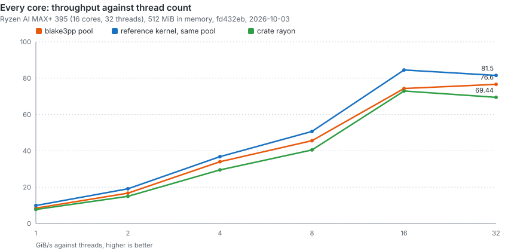
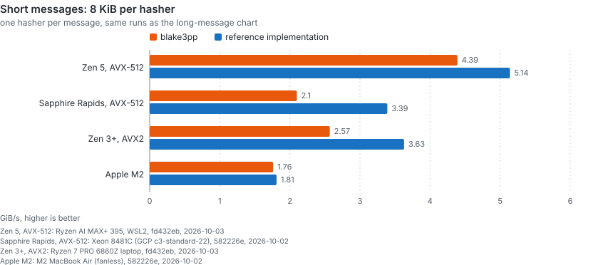

# Performance

[← blake3pp](../README.md)

Three charts, each from one machine's own run with both implementations
measured in the same pass. The numbers are what `blake3pp_bench` printed;
every row names the commit and the day it ran, because a figure without
those is not a measurement.

What is being compared. **blake3pp** is this library end to end, through
its own dispatch. **reference** is the BLAKE3 reference implementation in
its own configuration: the upstream C library with its hand-written
assembly kernels, and the `blake3` crate over rayon for the parallel rows.
The benchmark builds both (`BLAKE3PP_BENCH_UPSTREAM`,
`BLAKE3PP_BENCH_COMPARE`) and runs them alternately. That alternation is
what makes a one-machine comparison mean anything.

## One core, a long message


The spread across microarchitectures is the point. The same C++ is ahead on
Zen 5 and Neoverse V2, level on Apple's M2, and behind upstream's assembly
on Sapphire Rapids and Zen 3+. Where the gap is ours it is in the kernel
rather than in the tree: the benchmark also runs upstream's assembly inside
this library's pipeline, and that row tracks the reference implementation's
own.

## Every core



`blake3pp/pool` is the engine over its std::execution pool.
`reference/pool` is the same engine with upstream's kernel swapped in, so
the two differ only in the kernel. `crate rayon` is the reference
implementation's own parallel path. Both scale; what the chart shows is
that a sender/receiver engine costs nothing against a work-stealing pool
built for the job.

## Short messages



8 KiB per hasher, one hasher each: no tree worth spreading over cores and
no long run to amortise a wide batch over, which is the shape that shows
per-call overhead rather than kernel throughput. This is where the library
is furthest behind on x86, and the gap is the dispatch and setup cost per
hasher rather than the compression itself.

## Extended output

Not a chart, because two machines is not a trend, but the asymmetry is worth
stating: generating extended output runs at 10.4 GiB/s here against the
reference implementation's 11.3 on Zen 5, where both have an AVX-512 path
for it, and at 4.70 against 1.21 on Zen 3+, where the reference
implementation has no wide path for extended output at all and falls back to
one block at a time. Both figures are from the runs above.

## Reproducing any of it

```bash
cmake --preset linux-gcc16-cxx26 -DBLAKE3PP_BENCH_COMPARE=ON
cmake --build build/linux-gcc16-cxx26 --target blake3pp_bench blake3pp_bench_compare
./build/linux-gcc16-cxx26/bench/blake3pp_bench --size 512 --reps 5 --cooldown 5
```

[bench/README.md](https://github.com/pysco68/blake3pp/blob/main/bench/README.md)
documents the rows, what the `--null-source` ceiling means and what the
file bench measures;
[bench/compare/README.md](https://github.com/pysco68/blake3pp/blob/main/bench/compare/README.md)
has the protocol for a comparison whose numbers are meant to be quoted.
The charts themselves are rendered by `tools/bench-charts.py` from
`docs/data/charts.json`, which holds the extracted rows of each run.
